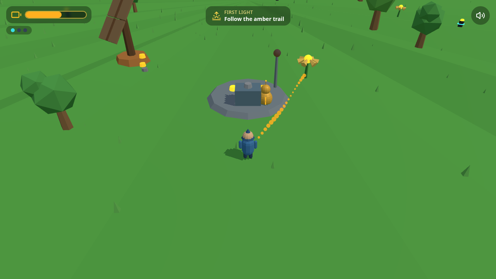

# SPARK: Save My Robot

**A game where a curious kid saves their dying robot — by learning real robotics.**



Bolt the robot is running out of charge. Explore an open world, harvest energy,
wire real circuits, and learn how robots sense, think, and act — one quest at a
time. Built for kids aged 6–14.

## Status: Zone 1 vertical slice

Zone 1 — *Meadow of Beginnings* — is playable end to end:

- **First Light** — follow the amber trail and charge the first flower
- **Snack-Bar Hunt** — collect 5 charge cells scattered across the meadow
- **The Tether** — wire a real circuit (out *and* back!) to wake the harvester
- **Dyna's Patrol** — visit 4 patrol stations with Dyna the drone
- **Sunset Crossing** — predict your charge, carry the lantern, cross the gate
- **Bolt's Reboot** — the ceremony, and a new move: **charge-dash**

A playtest link is shared privately with testers during this phase.

## Run it locally

```bash
npm install
npm run dev      # dev server
npm run build    # production build -> dist/
```

Works on desktop (WASD / arrows / Shift) and touch (floating joystick,
tap-to-move, dash button).

## Tech

- TypeScript + React 19 + Vite
- Three.js (raw game loop, procedural low-poly world — no game engine)
- WebAudio-synthesized sound (no audio assets)
- Tailwind CSS + shadcn/ui for the HUD

## Project layout

```
src/game/engine.ts   # the whole game: quests, wiring, energy, companions
src/game/audio.ts    # synthesized sound effects
src/pages/Home.tsx   # React HUD + touch input layer
```

## Roadmap

1. Playtest Zone 1 with kids, iterate on feedback
2. Zones 2+ — new robotics concepts per the game design document
3. Native iOS/Android build
